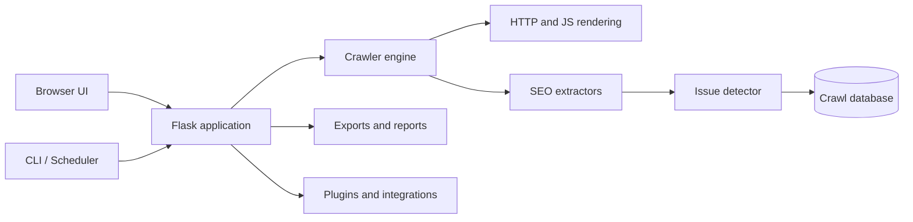

# Deep Crawling

<div align="center">


### Open-source SEO crawler, technical auditor and website intelligence platform

<a href="https://github.com/elisir80/Deep-Crawling"></a>
<a href="https://github.com/elisir80/Deep-Crawling/blob/main/LICENSE"></a>


<strong>Discover every URL. Understand every issue. Improve every site.</strong>
</div>

## Overview

Deep Crawling is a self-hosted, open-source website crawler for technical SEO audits, content analysis, link intelligence and site monitoring. It combines a live browser interface with CLI workflows, scheduled crawls, project storage, exports and an extensible plugin system.

It is designed for SEO specialists, developers, agencies and site owners who want a transparent alternative to closed crawler platforms while keeping crawl data under their own control.

## Highlights

- **Self-hosted and privacy-friendly** — run locally, on a private server or in Docker.
- **Real-site crawling** — HTML, JavaScript applications, sitemaps and URL lists.
- **Actionable findings** — page-level evidence, grouped issues and exportable reports.
- **Large-crawl aware** — incremental polling, virtualized views and background workflows.
- **Extensible** — custom tabs and analyses through the plugin system.
- **Automation ready** — CLI, scheduler, webhooks and API endpoints.

### Crawling and rendering

- Spider, URL-list and XML sitemap crawl modes
- JavaScript rendering for React, Vue, Angular and dynamic websites
- Source HTML, rendered HTML, extracted text and metadata
- Internal/external links, redirects, canonicals and hreflang
- Robots directives, HTTP headers, cookies, resources and timing
- Crawl depth, queue progress, rate limiting and live statistics

### Technical SEO analysis

- Missing, duplicate and oversized titles and meta descriptions
- Heading structure, word count and thin-content signals
- Broken links, redirect chains, server errors and no-response URLs
- Images, alt text, dimensions, formats and resource weight
- Structured data, JSON-LD, accessibility and HTML validation
- PageSpeed and Core Web Vitals integrations

### Professional workflows

- Saved projects, crawl import/export and historical comparisons
- CSV, JSON, XML and Markdown issue reports
- Scheduled crawls with webhook and email notification support
- Multi-user authentication and administrator controls
- Portfolio, enterprise SEO and custom extraction modules
- Google Analytics 4, Search Console, Bing and PageSpeed adapters

## Quick start

### Automatic setup

```bash
git clone https://github.com/elisir80/Deep-Crawling.git
cd Deep-Crawling
chmod +x start-librecrawl.sh
./start-librecrawl.sh
```

On Windows, run `start-librecrawl.bat`. Then open [http://localhost:5000](http://localhost:5000).

### Docker

```bash
git clone https://github.com/elisir80/Deep-Crawling.git
cd Deep-Crawling
cp .env.example .env
docker compose up -d
```

### Python

```bash
python3 -m venv .venv
source .venv/bin/activate
pip install -r requirements.txt
playwright install chromium
python main.py --local
```

For authenticated deployments, set a persistent secret before starting:

```bash
export SECRET_KEY="$(python -c 'import secrets; print(secrets.token_hex(32))')"
python main.py
```

## CLI examples

```bash
# Crawl a site and save a JSON report
python librecrawl_cli.py https://example.com --output report.json

# Crawl a list of URLs
python librecrawl_cli.py --mode list --seed https://example.com/ --seed https://example.com/about

# Crawl an XML sitemap
python librecrawl_cli.py --mode sitemap --seed https://example.com/sitemap.xml

# Run a recurring crawl every 24 hours
python librecrawl_scheduler.py https://example.com --interval 86400 --webhook https://example.net/crawl-hook
```

## Architecture



## Plugin system

Drop a JavaScript plugin into `web/static/plugins/` and register a new tab:

```javascript
LibreCrawlPlugin.register({
  id: 'content-opportunities',
  name: 'Content Opportunities',
  tab: { label: 'Content', icon: '✍️' },
  onTabActivate(container, data) {
    container.textContent = `Analysing ${data.urls.length} URLs`;
  }
});
```

See [the plugin documentation](web/static/plugins/README.md) for the full API.

## Security and deployment

- Keep `.env`, databases, crawl history, credentials and browser profiles out of commits.
- Use HTTPS, a persistent `SECRET_KEY`, authentication, firewall rules and a non-root service account for internet-facing deployments.
- Review [`deploy/setup-server.sh`](deploy/setup-server.sh) for the hardened systemd example.

## Project status

Deep Crawling is actively evolving toward a complete professional SEO crawler. The current implementation includes the crawler engine, web workspace, project workflows, enterprise SEO modules, CLI automation and extensibility foundations.

See [the Screaming Frog parity matrix](docs/SCREAMING_FROG_PARITY.md) for current coverage and known differences.

## Contributing

```bash
python -m compileall -q main.py src librecrawl_cli.py librecrawl_scheduler.py
pytest -q
git diff --check
```

Please read [CONTRIBUTING.md](CONTRIBUTING.md) and keep credentials and crawl databases out of commits.

## License and links

Deep Crawling is free and open source under the terms of the [LICENSE](LICENSE).

- [Repository](https://github.com/elisir80/Deep-Crawling)
- [Issues and feature requests](https://github.com/elisir80/Deep-Crawling/issues)
- [Parity matrix](docs/SCREAMING_FROG_PARITY.md)
- [Plugin documentation](web/static/plugins/README.md)
